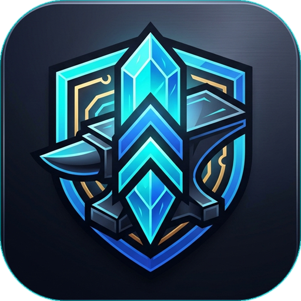

<div align="center">



# Modern RO Patcher & Builder Toolchain

**Next-generation, ultra-fast client patcher and visual builder studio for Ragnarok Online.**  
Built with **Rust 2021 + Microsoft Edge WebView2** &mdash; zero false positive antivirus flags, single self-contained executable, and true web-standard UI customization.

[](https://www.rust-lang.org/)
[](https://v2.tauri.app/)
[](https://developer.microsoft.com/en-us/microsoft-edge/webview2/)
[](LICENSE)
[](https://www.microsoft.com/windows)

[Key Features](#-key-features) • [Workspace Architecture](#-workspace-architecture) • [Quick Start](#-quick-start) • [Building From Source](#-building-from-source) • [Patch Format & Hosting](#-patch-format--hosting) • [Contributing](#-contributing)

</div>

---

## 🌟 Overview

Legacy Ragnarok Online patchers (such as Thor Patcher, NeonCube, and old Delphi/MFC tools) are plagued by outdated Internet Explorer (Trident/MSHTML) rendering bugs, aggressive antivirus false-positives, slow single-threaded downloads, and dangerous complete GRF rewrites that can corrupt multi-gigabyte archives.

**Modern RO Patcher** re-engineers the entire patching workflow from the ground up:
- **Players** get a sleek, animated, modern client patcher that downloads updates at gigabit speeds with automatic mirror failovers.
- **Server Owners & Administrators** get an intuitive, visual desktop studio (`patcher-builder`) to configure servers, customize web themes, inspect game folders, package `.thor` patches, and export standalone single-file executables with one click.
- **Developers** get a modular, memory-safe Rust workspace with high-performance crates for GRF/THOR handling, PE resource injection, and binary overlay storage.

---

## ⚡ Key Features

### 🖥️ Client Patcher (`patcher-template`)
- **Single Executable Distribution**: Compiles to a clean, standalone `.exe`. No messy external `.dll` files, configuration folders, or sidecar files required.
- **Antivirus Safe**: Written in 100% memory-safe Rust with standard PE headers and signed WebView2 rendering. Zero false-positive heuristic flags.
- **Modern Web UI Engine**: Powered by Microsoft Edge WebView2 (Chromium). Build custom patcher interfaces with HTML5, CSS3, modern animations, sound effects, and JavaScript frameworks.
- **Frameless Glassmorphism**: Native support for frameless transparent windows, custom draggable titlebars, and modern UI transitions.
- **Lightning-Fast In-Place GRF Merging**: Appends new file entries directly to the GRF table in-place without rewriting the entire 2–4 GB archive, reducing patch installation time from minutes to milliseconds.
- **Multi-Stream Downloader**: Download up to 32 parallel streams with automatic resume, bandwidth throttling, and SHA-1 data integrity validation.
- **Parallel Mirror Failover**: Automatic health-checking probes across multiple CDN/mirror servers with seamless failover if the primary host goes down.
- **Seamless Self-Updating**: Automatically replaces and restarts itself when an updated patcher binary is included in a patch package.

### 🛠️ Visual Builder Studio (`patcher-builder`)
- **Visual Patcher Generator**: Real-time form for patch servers, game client executables, launch arguments, and window dimensions.
- **One-Click Game Folder Auto-Scan**: Automatically discovers game executables, setup programs, GRF archives, and game icons.
- **Custom PE Icon Embedding**: Embeds your custom `.ico` directly into the Windows executable resources before packaging.
- **Full Thor Maker Replacement (`.thor` Patch Maker)**:
  - **Output Modes**: Choose between `RO - GRF` (merge into archive) or `File` (extract directly into root game directory), with support for leaving target GRF blank to use the patcher's default archive.
  - **Input Source Modes**: Pack recursively from a `Directory` (with automatic OS junk filter for `thumbs.db`, `desktop.ini`, `.DS_Store`), a `Single File` with custom target relative paths, or `Patcher & Game EXE`.
  - **Zlib Compression Levels**: Selectable `Low` (Fast), `Medium`, or `High` (Best compression) ratios.
  - **Filename Encodings**: Full support for Korean Unicode filenames (`CP949` / `EUC-KR`) and legacy ASCII (`Windows-1252`).
  - **File Deletion Queue**: Interactive delete list, import paths from `.txt` files or clipboard, supporting combined add+delete or delete-only patches.
  - **Automated `plist.txt` Manager**: Increments patch numbers and appends entries automatically.
- **Bilingual Interface**: Native switch between English (EN) and Thai (TH), with dark and light theme toggling.

---

## 📐 Workspace Architecture

```
ro-patcher-builder/
├── apps/
│   └── patcher-builder/        # Visual Desktop GUI Builder (Tauri v2 + Vanilla HTML/CSS/JS)
│       ├── src/                # Modern UI Frontend (Themes, i18n, Form Handlers)
│       └── src-tauri/          # Builder Backend (PE updating, overlay attaching, scan APIs)
│
├── crates/
│   ├── patcher-template/       # Base Player Patcher Executable (wry / WebView2 runtime)
│   ├── patcher-core/           # Engine logic (Download queue, GRF merge, cache, overlay trailer)
│   ├── patch-maker/            # CLI and library for packaging .thor patches & updating plist
│   └── gruf/                   # High-performance GRF v2.0 and THOR archive reader/writer
│
├── themes/
│   └── modern-cyber/           # Sleek cyberpunk neon web theme (HTML/CSS/JS)
│
├── template-dist/
│   ├── patcher_base.exe        # Pre-built base template binary for rapid generator packaging
│   └── default_icon.ico        # Default multi-resolution project icon
│
├── Cargo.toml                  # Cargo workspace definition
└── README.md
```

---

## 🚀 Quick Start

### 1. Generating a Player Patcher (.exe)
1. Launch **Modern RO Patcher Builder** (`patcher-builder.exe`).
2. Go to **Server & Mirrors**: Enter your `plist.txt` URL and patch files directory.
3. Go to **Game & GRF**: Enter your game executable (e.g., `ragexe.exe`), launch parameters (`-1rag1`), and default target GRF (e.g., `data.grf`).
   *(Tip: Click **Auto-Scan Game Folder** on the sidebar to detect these automatically!)*
4. Go to **UI Theme & Window**: Select your window size, toggle transparent frameless style, and pick a custom `.ico` icon.
5. Click **Generate Patcher** &rarr; **GENERATE STANDALONE PATCHER (.EXE)**.
6. Distribute the generated single `.exe` file directly to your players!

### 2. Creating a `.thor` Update Patch
1. Switch to the **Patch Maker (.thor)** tab.
2. Select your **Input Source** (`Directory`, `Single File`, or `Patcher EXE`).
3. Choose your **Output Target Mode**:
   - `RO - GRF`: Merges files into your target GRF (leave blank to merge into the patcher's default GRF).
   - `File`: Extracts files directly into the root game directory.
4. Select **Compression Level** (`High`, `Medium`, or `Low`) and **Filename Encoding** (`Unicode CP949` or `ASCII`).
5. (Optional) Switch to **Delete File** tab to add files that should be deleted from client GRF or game folders.
6. Set your destination `.thor` path and click **Generate THOR Patch**.

---

## 🛠️ Building From Source

### Prerequisites
- [Rust toolchain](https://rustup.rs/) (1.75+ recommended, 2021 edition)
- Windows 10 or 11 with [Microsoft Edge WebView2 Runtime](https://developer.microsoft.com/en-us/microsoft-edge/webview2/) (pre-installed on modern Windows)
- C++ Build Tools (via Visual Studio Installer or Build Tools for Visual Studio)

### Build Steps

Clone the repository:
```bash
git clone https://github.com/asakura415/ro-patcher-builder.git
cd ro-patcher-builder
```

Run test suite:
```bash
cargo test --workspace
```

Compile release binaries:
```bash
cargo build --release --workspace
```

Prepare the base template binary:
```powershell
Copy-Item -Path "target\release\patcher-template.exe" -Destination "template-dist\patcher_base.exe" -Force
```

The output executables will be located in `target/release/`:
- `patcher-builder.exe` &mdash; Visual Studio & Patcher Builder GUI
- `patcher-template.exe` &mdash; Base standalone client patcher
- `patch-maker.exe` &mdash; Command-line `.thor` patch generator

---

## 🌐 Patch Format & Hosting

### Patch List (`plist.txt`)
Host your `plist.txt` on any standard HTTP/HTTPS web server, CDN, or object storage (Cloudflare R2, AWS S3, Nginx, Apache).

Format:
```text
// Index  PatchFileName.thor
1         001_initial_data.thor
2         002_custom_items.thor
3         003_system_update.thor
```

### Server Configuration
- **Patch URL Directory**: Must be an HTTP(S) directory containing the `.thor` files ending with a trailing slash (`/`), for example:
  ```
  http://patch.myserver.com/patch/
  ```

---

## 🤝 Contributing

Contributions, issues, and feature requests are welcome!
Feel free to check [issues page](https://github.com/asakura415/ro-patcher-builder/issues) if you want to contribute.

1. Fork the repository
2. Create your feature branch (`git checkout -b feature/AmazingFeature`)
3. Commit your changes (`git commit -m 'Add some AmazingFeature'`)
4. Push to the branch (`git push origin feature/AmazingFeature`)
5. Open a Pull Request

---

## 📄 License

This project is licensed under the MIT License - see the [LICENSE](LICENSE) file for details.

---

<div align="center">
Made with ❤️ for the Ragnarok Online private server community.
</div>
